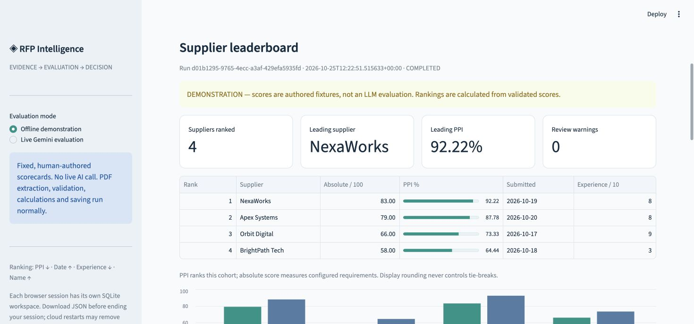
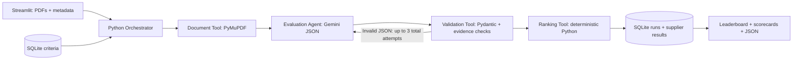
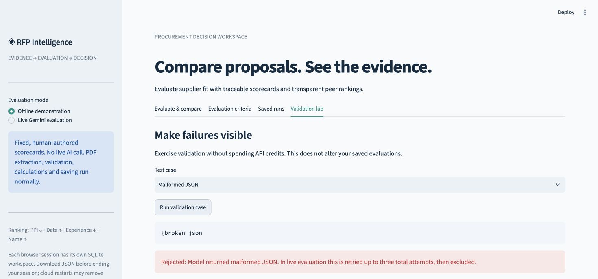

# RFP Intelligence

[](https://github.com/rahulsharmarallapalli-tech/agentic-rfp-evaluation/actions/workflows/tests.yml)

An evidence-based supplier evaluation app built for the **Agentic RFP Evaluation and Supplier Ranking** mini project. Streamlit provides the interface, SQLite owns the criteria and saved results, Gemini judges proposal evidence, and Python owns all scoring and ranking.

**Demo honesty:** the one-click offline demonstration uses explicitly human-authored scorecards for the four bundled PDFs. It still executes extraction, validation, scoring, benchmarking, ranking and persistence. Live evaluation is a separate mode requiring your own Gemini API key.



## Quick start

Python **3.12** is the tested version.

```bash
python -m venv .venv
source .venv/bin/activate
# Windows: .venv\Scripts\activate
pip install -r requirements.txt
python -m scripts.seed_db
streamlit run app.py
```

Choose **Offline demonstration → Run four-supplier demo**. No key is required. Download the complete JSON or inspect a supplier's page-referenced evidence. For live evaluation, choose **Live Gemini evaluation**, enter a key and an available model, upload 2–10 PDFs, supply metadata and consent to sending extracted text to Google.

The app defaults to `gemini-2.5-flash`; the model field is editable because account access and model availability can change. No secret is embedded in the source, SQLite, fixtures or exports. The key is held in session memory and used only in the provider request header. The **Forget API key** button clears it from the session widget.

## Architecture

Design documents: [High-level design](docs/HLD.md) · [Low-level design and SQL schema](docs/LLD.md) · [Rubric traceability](docs/RUBRIC.md).



The orchestrator reloads active criteria before each batch, creates a UUID run ID, processes each supplier independently, normalizes scorecards, computes the cohort's benchmarks, sorts suppliers, and persists the complete result. Errors become visible failures. Partial cohorts are explicitly provisional.

## SQLite: actual SQL persistence

`python -m scripts.seed_db --db data/rfp.sqlite` creates and seeds an idempotent database. The application creates the same schema automatically for each browser workspace.

| Table | Fields |
|---|---|
| `evaluation_criteria` | `criterion_id`, `name`, `description`, `weight`, `max_score`, `is_active` |
| `rfp_runs` | `rfp_run_id`, `created_at`, `status`, `run_json` |
| `supplier_results` | `rfp_run_id`, `supplier_name`, `submission_date`, `experience_rating`, `absolute_score`, `ppi`, `final_rank`, `result_json` |

Foreign keys link results to runs. A transaction stores the final run and all ranked supplier rows together. Values use parameterized SQL. Each saved run includes a criteria snapshot, source-page text and SHA-256 fingerprints, validated evidence, metrics, warnings, failures, model/mode and workflow trace.

For a public classroom app, each browser session receives its own SQLite file under `data/sessions/`; visitors cannot view another session's history through the UI. A fresh browser session starts a new workspace. The CLI uses durable named database paths. SQLite is local disk storage, not hosted durable storage: Streamlit Cloud restarts or redeployments may remove it. Download JSON before leaving. Production multi-user authentication and durable external storage are outside this classroom scope.

## Formulas and tie-breaks

For criterion `c`, score `s`, configured maximum `m`, weight `w` (active weights total 100):

```text
Absolute score = Σ (s / m) × w                       [0–100]
Benchmark(c)   = max validated score in this cohort
Gap(c)         = s − Benchmark(c)                    [≤ 0]
Relative %(c)  = 100 × s / Benchmark(c), or 0 if benchmark is 0
PPI            = Σ (Relative %(c) × w) / 100          [0–100]
```

Zero-benchmark criteria retain their weight; a cohort with no evidence gets no credit. Only successful supplier evaluations participate in benchmarks. These are **peer benchmarks**, not sourced industry norms.

Sort by **higher PPI → earlier submission date → higher historical experience rating → supplier name ascending**, then assign sequential ranks. Name sorting is case-insensitive; duplicate normalized names are rejected. Decimal calculations avoid binary floating-point tie noise. Display rounding to two decimals does not determine rank. The LLM never decides a benchmark, formula, tie-break or final rank.

## Validation and reliability

- Enforce 2–10 suppliers; unique names; experience from 0 to 10; active weights totaling 100; positive maximum scores.
- PDFs: maximum 10 MB, 50 pages and 100,000 extracted characters; reject encrypted, damaged, empty and scan-only files with an actionable message. No silent text truncation or OCR claim.
- Prompt demands one result per active criterion, only document evidence, valid JSON and bounded scores. Proposal text is explicitly untrusted data.
- Parse JSON (including optional code fences); reject malformed top-level responses and non-finite JSON numbers.
- Fill missing criteria with zero; ignore unknown IDs; retain the first duplicate with a warning; clip numeric scores; reject nonnumeric/boolean scores as zero.
- Require matching source quotations for positive scores; locate or correct page references. Quote matching is whitespace- and case-normalized and verifies presence, not truth.
- Three total attempts per supplier for malformed JSON and retryable connection/429/5xx errors; backoff of 1 then 2 seconds. Authentication and bad-request errors do not retry. Each HTTP request has a 10-second connection and 90-second read timeout.
- Failed suppliers are recorded separately and excluded; successful but normalized zero scores remain visible with warnings. No fallback fabricated AI scorecard is used in live mode.
- Keys and provider response bodies are not logged or persisted. Raw PDFs stay in upload memory; source text and evidence are saved in the run and included in its export.

## Samples and tests

Four three-page fictional proposals respond to the same customer-service-platform procurement: Apex Systems (technical/security strength), BrightPath Tech (low price/weak compliance), NexaWorks (delivery/support strength), Orbit Digital (experience/vague integration).

```bash
pip install -r requirements-dev.txt
python -m pytest -q
python -m scripts.run_demo
```

The demo writes `data/demo.sqlite` and [samples/completed_run.json](samples/completed_run.json). To regenerate the fictional PDFs and scorecards, run `python -m scripts.generate_samples`, then regenerate the demo export. The fixture evaluator checks document hashes; it cannot silently score arbitrary uploads.

Tests cover independently calculated formulas with unequal maxima, zero benchmarks, every tie-break level, unrounded sorting, malformed JSON, clipping, missing criteria, unknown IDs, invented evidence, invalid/encrypted PDFs, provider errors and retry bounds, database transactions and immutable snapshots, reproducible demo output, and Streamlit UI interactions. Provider calls are mocked; a real Gemini call needs a user-supplied key.

See [the demo script](docs/DEMO.md) for a successful run and validation/error demonstration, and [rubric traceability](docs/RUBRIC.md) for the implementation mapped to all 100 marks.



## Streamlit Community Cloud deployment

1. Publish this directory as a public GitHub repository. Do not upload `.venv`, databases or API keys.
2. In [Streamlit Community Cloud](https://share.streamlit.io/), choose **Create app**, select the repository and branch `main`, and set the entry point to **`app.py`**.
3. In advanced settings select **Python 3.12**. `requirements.txt` provides all runtime dependencies. No cloud secret is required for the offline demo or session-only BYOK mode.
4. Deploy, open the public app URL in a fresh browser, run the four-supplier demo, and exercise the validation lab. Submit both the repository URL and verified app URL.

Official references: [Gemini generateContent API](https://ai.google.dev/api/generate-content), [Streamlit deployment instructions](https://docs.streamlit.io/deploy/streamlit-community-cloud/deploy-your-app/deploy).

## Project layout

```text
app.py                    Streamlit interface
rfp/models.py             Pydantic schemas and criteria invariants
rfp/document.py           PDF extraction and source fingerprints
rfp/evaluator.py          Gemini client, prompt and explicit demo fixtures
rfp/validation.py         Normalization and evidence verification
rfp/ranking.py            Decimal scoring and deterministic sorting
rfp/orchestrator.py       Workflow, retries, failures and run lifecycle
rfp/db.py                 SQL schema, seed, criteria and transactional persistence
scripts/                  Database seed, sample generation, CLI demo
samples/proposals/        Four fictional three-page PDFs
samples/evaluations/      Human-authored demo scorecards
samples/completed_run.json Complete exported demo run
tests/                    Unit, integration and Streamlit tests
docs/                     Demonstration and rubric mapping
.github/workflows/         Automated test workflow
```

## Scope and limitations

This is a classroom decision-support tool, not an autonomous procurement award system. Live LLM judgments may vary; validated scores always produce the same formulas and ordering. Human reviewers must assess the relevance and truth of evidence, supplier assertions, and missing terms. OCR, independent certification checks, production authentication, durable cloud storage and semantic prompt-injection immunity are not claimed.

PyMuPDF is AGPL/commercial dual-licensed; review its license before adapting this educational repository for a different distribution model.
