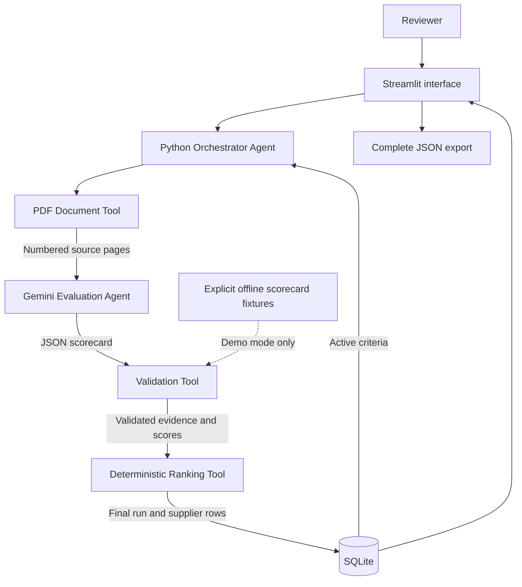
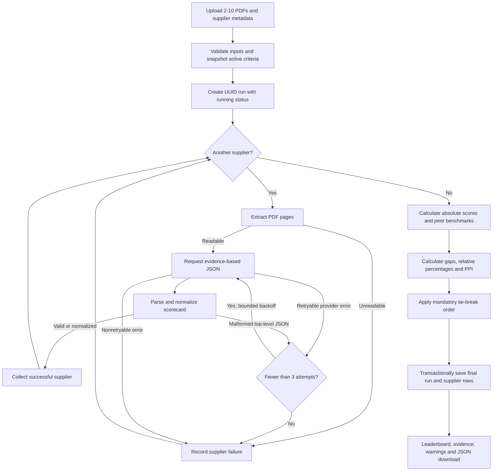

# High-level design

## Purpose and scope

RFP Intelligence evaluates fictional supplier proposals for a common procurement request. It separates evidence-based LLM judgment from deterministic business rules, with a complete auditable result stored in SQLite.

There are **five workflow components**, not five independent LLMs. The two agent roles are a Python Orchestrator Agent and an LLM Evaluation Agent. Document extraction, validation and ranking are deterministic tools. The orchestrator invokes the same evaluator separately for each supplier. No LangGraph dependency is required by this lightweight implementation.

| Component | Responsibility | Technology |
|---|---|---|
| Orchestrator Agent | Load criteria, route tools, bound retries, isolate failures, save run | Python |
| Document Tool | Extract numbered pages and document fingerprint | PyMuPDF |
| Evaluation Agent | Score one supplier against active criteria and quote evidence | Gemini JSON API |
| Validation Tool | Parse, normalize, verify quotation presence, warn | Python and Pydantic |
| Ranking Tool | Weighted scores, benchmarks, gaps, relative percentages, PPI and tie-breaks | Python Decimal |

## System boundary

Gemini is the only external runtime service. The app sends extracted text only after the reviewer chooses live mode and consents. An API key exists in session memory and the request header, never in database rows or exports. The offline path uses hash-matched, human-authored fixtures and is labeled accordingly throughout the application.

## End-to-end workflow

## Data and deployment

The three tables are `evaluation_criteria`, `rfp_runs` and `supplier_results`. A run stores a historical configuration snapshot so edits affect only subsequent evaluations. Foreign keys associate supplier rows with one run ID. Each browser session has an isolated SQLite file; CLI commands support a named persistent file. Local cloud storage may be lost on restart, so exported JSON is the portable record.

Deployment is a public GitHub repository feeding Streamlit Community Cloud, entry point `app.py`, Python 3.12. GitHub Actions installs dependencies, runs the automated tests and reproduces the demo.

## Quality and tradeoffs

- Four fictional three-page PDFs satisfy the brief's minimum of four proposals, each 2-4 pages. The upload flow also accepts cohorts of 4-8 within its 2-10 limit.
- Fixed validated scores deterministically reproduce formulas and ordering; live LLM scores may vary.
- A failed supplier is excluded and the cohort is visibly partial. No silent fallback replaces a failed live evaluation with a fixture.
- Evidence matching verifies a quotation exists, not that its claim is true or sufficient. Human procurement review remains necessary.
- No industry baselines, OCR, independent certificate verification, autonomous award decisions or production multi-user authentication are claimed.

See [LLD.md](LLD.md) for interfaces, schema, calculations and failure behavior, and [RUBRIC.md](RUBRIC.md) for assessment traceability.
