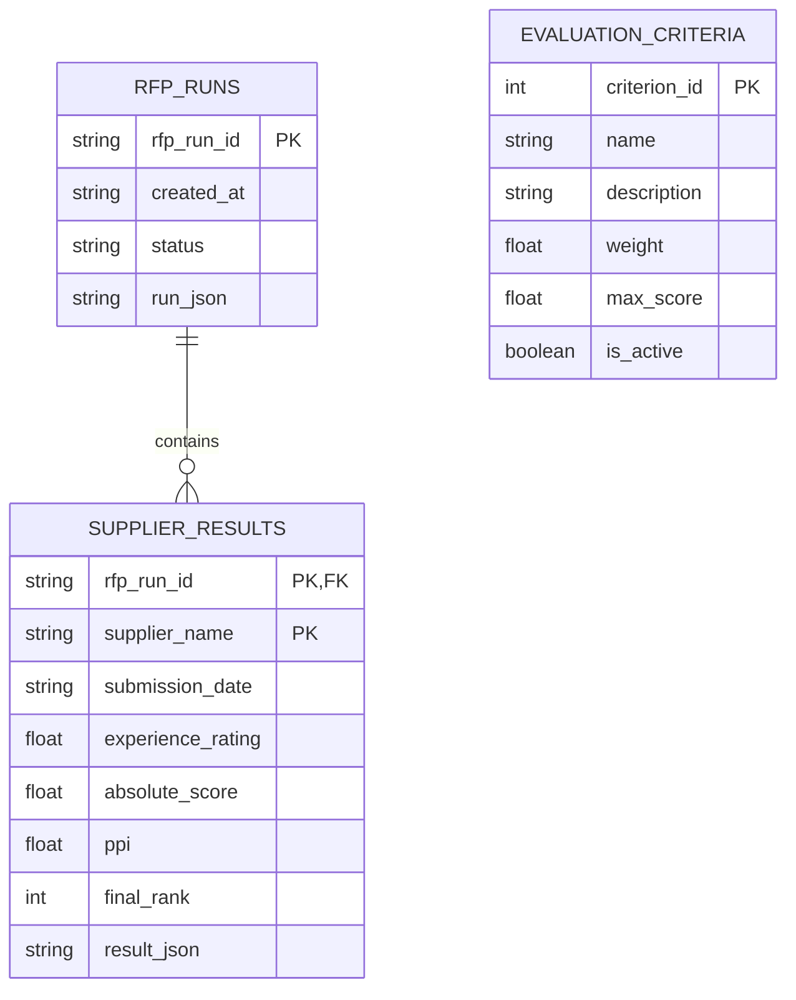

# Low-level design

## Module contracts

| Module / interface | Input | Output and responsibility |
|---|---|---|
| `models.Supplier` | Name, ISO date, experience | Trimmed name, parsed date, finite rating 0-10 |
| `models.Criterion` | ID, name, description, weight, maximum, active | Validated criterion |
| `models.active_criteria` | Criteria list | Active, ID-sorted criteria; unique IDs and weights totaling 100 |
| `db.init_db(path)` | SQLite path | Idempotent schema and initial five criteria |
| `document.extract_pdf(bytes)` | PDF bytes | SHA-256, page count, numbered page text, extraction warnings |
| `evaluator.build_prompt(...)` | Supplier, criteria, document | JSON-only evidence prompt with dynamic configuration |
| `GeminiEvaluator.evaluate(...)` | Same inputs | Provider response text or sanitized `ProviderError` |
| `validation.validate_response(...)` | Raw JSON, criteria, trusted name, pages | Pydantic `Evaluation` with normalized criterion results |
| `ranking.rank_suppliers(...)` | Successful validated suppliers and criteria | Ranked supplier records with all deterministic metrics |
| `orchestrator.evaluate_batch(...)` | Supplier/PDF pairs, database, evaluator, progress callback | Saved complete/partial/failed run |
| `db.save_run(path, run)` | Run dictionary | Atomic parent-run and child-supplier writes |

## SQL schema

The executable source of truth is `rfp/db.py`; initialization and seeding are available through `python -m scripts.seed_db`.

```sql
CREATE TABLE evaluation_criteria (
  criterion_id INTEGER PRIMARY KEY,
  name TEXT NOT NULL,
  description TEXT NOT NULL,
  weight REAL NOT NULL CHECK(weight >= 0),
  max_score REAL NOT NULL CHECK(max_score > 0),
  is_active INTEGER NOT NULL CHECK(is_active IN (0,1))
);
CREATE TABLE rfp_runs (
  rfp_run_id TEXT PRIMARY KEY,
  created_at TEXT NOT NULL,
  status TEXT NOT NULL,
  run_json TEXT NOT NULL
);
CREATE TABLE supplier_results (
  rfp_run_id TEXT NOT NULL REFERENCES rfp_runs(rfp_run_id),
  supplier_name TEXT NOT NULL,
  submission_date TEXT NOT NULL,
  experience_rating REAL NOT NULL,
  absolute_score REAL NOT NULL,
  ppi REAL NOT NULL,
  final_rank INTEGER NOT NULL,
  result_json TEXT NOT NULL,
  PRIMARY KEY(rfp_run_id, supplier_name)
);
```



Criteria are copied into `run_json.criteria_snapshot`, rather than linked to mutable current rows. SQL parameter binding avoids constructing queries from supplier content. Connections enable foreign keys, use a 10-second lock timeout, commit or roll back through a context manager, and close explicitly.

## Scorecard contract

```json
{
  "supplier_name": "Apex Systems",
  "criteria": [{
    "criterion_id": 1,
    "score": 8,
    "max_score": 10,
    "justification": "Criterion-specific explanation",
    "evidence": "Exact contiguous quotation from one source page",
    "evidence_page": 1
  }],
  "risks": ["A point requiring clarification"],
  "overall_summary": "Proposal summary"
}
```

The normalized Pydantic `CriterionResult` adds `evidence_verified` and `warnings`. `Evaluation` also contains run-independent scorecard warnings. The source schema and numerical constraints are defined in `rfp/models.py`. JSON must contain an object and a criteria array; optional Markdown fences are tolerated. Nonfinite JSON constants are rejected.

| Condition | Result |
|---|---|
| Missing active criterion | Add score zero and warning |
| Unknown/malformed ID | Ignore row and warn |
| Duplicate criterion ID | Keep first row and warn |
| Nonnumeric or boolean score | Zero and warn |
| Numeric score outside range | Clip to configured range and warn |
| Wrong model maximum | Replace with database maximum |
| Wrong supplier name | Replace with trusted input name |
| Missing/unmatched quotation | Zero score; unverified evidence warning |
| Incorrect page number with matching quote | Locate actual source page and warn |
| Missing justification/summary or invalid risks | Safe fallback text and warning |

## Calculation example

With weights 60/40 and maxima 10/20, supplier A scores 8/10 and supplier B scores 4/20. Benchmarks are 8 and 20.

- A absolute = `(8/10)*60 + (10/20)*40 = 68`.
- B absolute = `(4/10)*60 + (20/20)*40 = 64`.
- A relative values = `100, 50`; PPI = `100*.6 + 50*.4 = 80`.
- B relative values = `50, 100`; PPI = `50*.6 + 100*.4 = 70`.
- A gaps = `0, -10`; B gaps = `-4, 0`.

Decimal precision is 40 digits. A zero peer benchmark yields relative 0 while retaining the criterion weight. The sort key is `(-unrounded_ppi, ISO_submission_date, -experience, name.casefold(), name)`. Normalized duplicate supplier names are rejected before processing. Ranks are sequential after sorting; each non-leading result identifies why the preceding supplier is ahead.

## Retry and run lifecycle

Runs start as `running`. The orchestrator processes suppliers sequentially with at most three evaluator attempts each. Malformed top-level JSON, network failures, HTTP 408/429 and selected 5xx responses retry after 1 and 2 seconds. Other HTTP failures stop that supplier immediately. Connect/read timeouts are 10/90 seconds. Retrying repeats the constrained prompt; there is no separate JSON repair agent.

All successful suppliers -> `completed`; some successful -> `partial`; none -> `failed`. Failed suppliers remain in `failures`, not the leaderboard. Final JSON and all successful supplier rows commit together. A process interruption can leave `running`; this classroom version has no restart/resume scheduler.

## Evaluation plan

`tests/test_ranking.py` uses independently hand-calculated expectations and tests every tie-break. Validation tests exercise malformed JSON, missing rows, clipped scores, nonfinite/boolean values and invented evidence. Pipeline tests verify retry limits, failure isolation, SQL integrity, atomic criteria rejection and immutable snapshots. Provider contract tests check JSON settings, headers, sanitized errors and timeouts without making paid calls. Streamlit tests run the demo and an error case.

The bundled four-supplier export is a reproducibility fixture, not a measurement of LLM quality. A live evaluation requires a reviewer-provided key; assess quote correctness, reasoning relevance and warning counts through manual source review. No unsupported model-accuracy percentage is reported.
